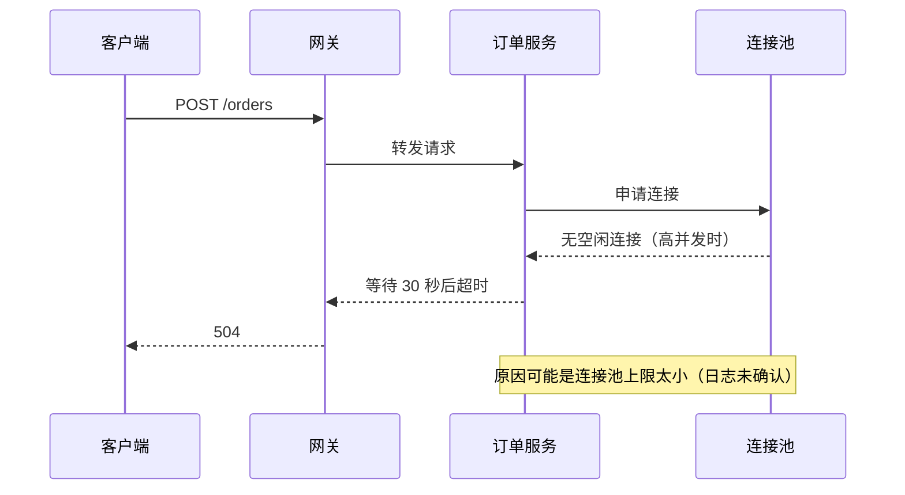
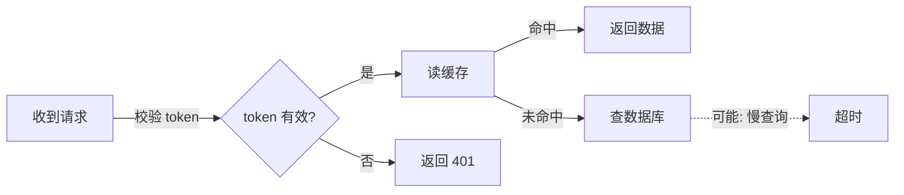

# 2 级：图

Karpathy："与其写字，不如让模型画一张图。图通常更容易处理、解析和理解。"

## 先选形式

| 内容 | 用什么 |
|---|---|
| 单纯的流程、判断分支 | Mermaid `flowchart` |
| 谁调用谁、按时间顺序 | Mermaid `sequenceDiagram` |
| 状态和状态之间的切换 | Mermaid `stateDiagram-v2` |
| 依赖关系 | Mermaid `flowchart`（不带判断节点） |
| 多个概念并排、标注一个真实例子、前后对比、限值 | 自包含 SVG 总览图 |

Mermaid 直接放在回复的代码块里，大多数界面能渲染。需要多面板布局、标注线、对比时才写 SVG。

## 通用规则

- **画机制，不画名词。** 两个框之间有箭头，箭头上就写清楚传的是什么：请求、token、某个值、"写入"、"阻塞"。没有标签的箭头只是装饰。
- **标签短。** 英文 ≤6 词，中文 ≤12 字，并且遵守当前严格度。长内容放进"说明"面板，用短句。
- **不确定画虚线。** 原文说"可能"的关系，用虚线，标签里带"可能"。Mermaid 用 `-.->`。
- **不画原文没有的东西。** 不加原文没提到的节点、数字、原因。需要示例值时标"示例"。未知关系标 `?`。
- **一张图回答一个问题。** 想说的事超过一件，拆成多张，或用 SVG 分面板。

## Mermaid 例子

调用顺序（带一条不确定的关系）：

````markdown

````

流程（不确定的分支用虚线）：

````markdown

````

## SVG 总览图

Karpathy 推文里配的那张图就是这种风格：一页工程图纸式的总览。

- **画布**：横向，`viewBox="0 0 1600 1000"` 左右。米白底 `#fbfaf7`，近黑墨色 `#1d1d1f`。一个"对/推荐"色（蓝 `#1f5fbf`），一个"错/不推荐"色（红 `#c0392b`），其余用灰。
- **边框和网格编号**：细边框，上下边写列号 1～8，左右写行号 A～D，读者可以说"看 B3"。
- **面板**：网格排列的矩形，每个左上角一个深色字母标签（A、B、C…）和大写标题。**一个面板一个概念**，最多 6 个。
- **标题栏**：右下角，写标题、主题、范围、日期、"第 1 页 共 1 页"。
- **字体**：标签用等宽字体 `ui-monospace, "SF Mono", Menlo, monospace`，标题用无衬线体。标签 11～13px，标题 14～16px。中文标签加 `"PingFang SC", "Noto Sans CJK SC", sans-serif`。
- **标记**：1px 细线；✓/✕ 表示状态；条形刻度表示上限（例如"句长上限 25"）；引线加短标签标注例子里的某个部分。
- **自包含**：不引用外部字体和图片。`<title>` 和 `<desc>` 放在最前面，方便读屏软件。

好用的面板类型：

| 面板 | 用来 |
|---|---|
| 树/结构 | 系统或文档的组成 |
| 标注例子 | 一条真实的句子、请求、代码，用引线标出每个部分 |
| 带 ✓/✕ 的表 | 允许与不允许、改前与改后 |
| 刻度条 | 上限、大小、预算 |
| 时间线 | 历史、事件顺序 |
| 时序 | 谁把什么发给谁，按顺序 |

### SVG 骨架

```svg
<svg xmlns="http://www.w3.org/2000/svg" viewBox="0 0 1600 1000"
     font-family="ui-monospace, 'SF Mono', Menlo, 'PingFang SC', 'Noto Sans CJK SC', monospace">
  <title>主题：总览</title>
  <desc>一句话说明这张图展示什么。</desc>
  <rect width="1600" height="1000" fill="#fbfaf7"/>
  <rect x="20" y="20" width="1560" height="960" fill="none" stroke="#1d1d1f" stroke-width="1.5"/>
  <!-- 网格编号：上下边写列号，左右边写行号 -->
  <g font-size="11" fill="#6e6e73" text-anchor="middle">
    <text x="117" y="14">1</text><!-- 每隔 195px 一个 -->
  </g>
  <!-- 面板 A -->
  <g transform="translate(40,40)">
    <rect width="500" height="420" fill="#fff" stroke="#c7c7cc"/>
    <rect width="28" height="28" fill="#1d1d1f"/>
    <text x="14" y="19" fill="#fff" font-size="14" text-anchor="middle" font-weight="700">A</text>
    <text x="40" y="19" font-size="14" font-weight="700" font-family="system-ui, sans-serif">面板标题</text>
    <!-- 面板内容 -->
  </g>
  <!-- 不确定的关系：虚线 -->
  <line x1="560" y1="200" x2="700" y2="200" stroke="#1d1d1f" stroke-dasharray="6 4"/>
  <text x="565" y="192" font-size="11">可能：慢查询</text>
  <!-- 标题栏，右下角 -->
  <g transform="translate(1180,840)">
    <rect width="380" height="120" fill="#fff" stroke="#1d1d1f"/>
    <text x="12" y="28" font-size="16" font-weight="700" font-family="system-ui, sans-serif">图纸标题</text>
    <text x="12" y="56" font-size="11">主题：…</text>
    <text x="12" y="76" font-size="11">范围：…</text>
    <text x="12" y="104" font-size="11">第 1 页 共 1 页</text>
  </g>
</svg>
```

画完能打开就打开看一眼：文字有没有重叠、超出面板。

## 更重的选择

需要可缩放、可导出 PNG/SVG、带主题切换的架构图时，可以改用 [tt-a1i/archify](https://github.com/tt-a1i/archify)（约 7.8 万星，MIT）。需要手绘风格可编辑的图时，可以用 [coleam00/excalidraw-diagram-skill](https://github.com/coleam00/excalidraw-diagram-skill)。两者都要另外安装，先问用户。
